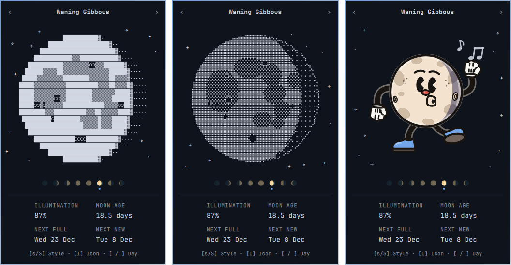
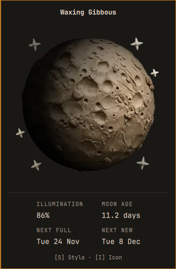

# Luna

A moon phase plugin for the Omarchy Quattro bar. Shows the current lunar
phase as a pill in the bar and renders it as stylized text or art in a popup —
fully offline, with no network calls.



## Install

```sh
omarchy plugin add https://github.com/salmun-nister/omarchy-luna.git --enable
```

Then add **Luna** to your bar from the bar editor, or move it to a section:

```sh
omarchy bar move salmun-nister.luna --section right
```

## Usage

- **Left-click** the pill — open/close the popup (Escape closes)
- **Middle-click** the pill, **click the moon**, or press **S** / **Enter**
  while the popup is open — cycle through different art styles
- **I** while the popup is open — toggle the pill icon between color emoji
  and a plain monochrome glyph that inherits the theme's text color
- **Right-click** the pill — desktop notification summarizing the phase
- **Tab** while the popup is open — switch to the neighboring panel

The disk is rendered at the exact phase fraction with lunar features loosely
inspired by the real near side: craters (Tycho, Copernicus, Kepler,
Aristarchus, Plato, Gassendi, Langrenus, Grimaldi) and dark maria (Imbrium,
Serenitatis, Tranquillitatis, Fecunditatis, Crisium, Nubium, Humorum and
Oceanus Procellarum); each appears only when its position is illuminated.
Stars twinkle around it.


The `clay` style draws the moon from eight plates, one per eighth of the
cycle, each rendered to look like a hand-worked clay sphere and lit for its
own phase. Neighbouring plates crossfade as the moon advances:



During a (umbral) lunar eclipse the panel shows a red "Partial/Total Lunar
Eclipse" line under the phase name, the moon art darkens under Earth's
shadow, and the bar pill shifts toward your theme's alert color with eclipse
depth. Every art style draws the same shadow: it enters at one limb, crosses
the disc as the event progresses, and goes coppery once totality swallows the
moon. The `clay` plates have no computed terminator, so the shadow is painted
over the clay surface and clipped to its circle.


## Settings

Settings are flat keys on the widget's entry in the `bar.layout` section of
`~/.config/omarchy/shell.json`:

```jsonc
{
  "id": "salmun-nister.luna",
  "artStyle": "blocks",   // "blocks" | "ascii" | "vector" | "cartoon" |
                          // "clay"; cycling rewrites this entry, and
                          // omitting it falls back to "blocks"
  "artRows": 19,          // 9–41 (odd enforced); text-art styles only;
                          // columns derive from the font's cell aspect so
                          // the moon stays circular
  "hemisphere": "north",  // "north" | "south" — defaults to north; set
                          // "south" if you're below the equator (mirrors
                          // the art/glyphs)
  "showPercent": false,   // append illumination % to the bar pill
  "plainIcon": true,      // pill icon: plain monochrome Nerd Font glyph
                          // (theme text color) instead of color emoji
  "clayBlend": true       // "clay" style only: crossfade between the two
                          // nearest plates instead of hard cuts
}
```

Each `artStyle` value renders the same phase differently:

- `blocks` — dot-matrix moon in `█ ▓ ·` glyphs (the default)
- `ascii` — the same shading in `@ # .` characters
- `vector` — a friendly cartoon moon drawn on a canvas
- `cartoon` — a 1930s rubber-hose moon drawn in theme colors
- `clay` — the moon as eight painted clay plates, one per eighth of the
  cycle, crossfaded as it advances; it ignores `artRows` and stays on the
  default 19-row layout, and `clayBlend: false` cuts between plates
  instead of blending

The text-art styles inherit your theme's foreground color automatically; the
canvas and clay styles use their own fixed palettes. The clay style was also
checked on a light theme.

## Accuracy

Phase fraction, illumination, and glyphs use the mean synodic month anchored
to a reference new moon. The *next new/full moon* timestamps go further:
periodic corrections from Meeus' "Astronomical Algorithms" (ch. 49) bring each
predicted instant to within a few minutes of true syzygy near J2000 (verified
against 2026 almanac data; a plain mean-month model drifts by up to half a day
and can even name the wrong day).

Lunar eclipses are computed with Meeus ch. 54 (lunar section) and validated
against NASA's catalog of 2026–2035 events: greatest-eclipse times within a
minute, umbral magnitudes within a few hundredths. Only *umbral* eclipses are
shown — penumbral-only events dim too subtly to see and are skipped. During an
eclipse the panel labels it, the art darkens under the shadow, and the bar
pill shifts red with depth.

## Update

```sh
omarchy plugin update salmun-nister.luna
```

## Remove

```sh
omarchy plugin remove salmun-nister.luna
```

## Future Considerations

- Add and improve art styles
- Add additional Easter eggs

Have a feature idea or found a bug? Open an issue.

## License

MIT — see [LICENSE](LICENSE).
