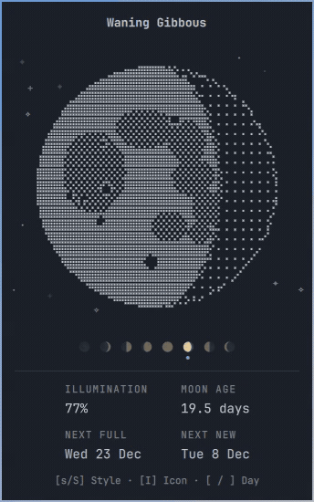
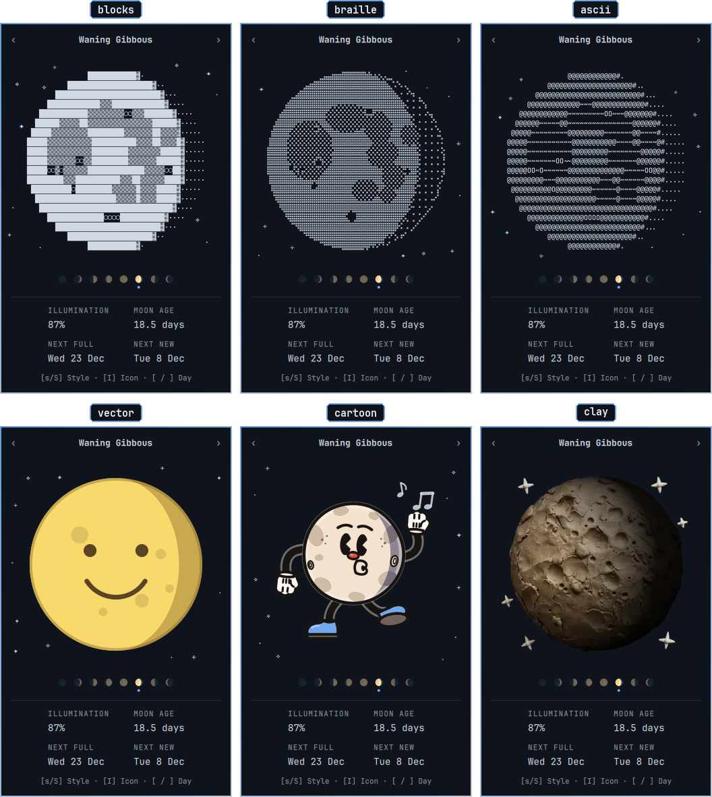
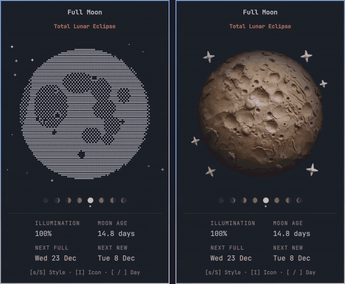

# Luna

A moon phase plugin for the Omarchy Quattro bar. Shows the current lunar
phase as a pill in the bar and renders it as stylized text or art in a popup —
fully offline, with no network calls.


## Install

```sh
omarchy plugin add https://github.com/salmun-nister/omarchy-luna.git --enable
```

Then add **Luna** to your bar from the bar editor, or move it to a section:

```sh
omarchy bar move salmun-nister.luna --section right
```

## Usage

- **Left-click** the pill — open/close the popup (Escape closes)
- **Middle-click** the pill, **click the moon**, or press **S** / **Enter**
  while the popup is open — cycle forward through the six art styles
  (**Shift+S** cycles in reverse)
- **I** while the popup is open — toggle the pill icon between color emoji
  and a plain monochrome glyph that inherits the theme's text color
- **%** while the popup is open — toggle appending illumination percentage to
  the bar pill (`showPercent`)
- **+** / **-** — grow or shrink the text-art grid (`artRows`)
- **B** — toggle plate crossfading in the `clay` style (`clayBlend`)
- **[** / **]**, **scroll wheel** over the moon, **‹** / **›** arrows, or
  clicking any glyph in the 8-phase strip — step backward or forward through
  days to preview past/future phases and eclipses (hover any strip icon for
  its phase and date; **T** or **0** snaps back to today)
- **Right-click** the pill — desktop notification summarizing the phase
- **Tab** while the popup is open — switch to the neighboring panel

The disk is rendered at the exact phase fraction with lunar features modeled
after the near side: craters (Tycho, Copernicus, Kepler, Aristarchus, Plato,
Gassendi, Langrenus, Grimaldi) and dark maria (Imbrium, Serenitatis,
Tranquillitatis, Fecunditatis, Crisium, Nubium, Humorum, and Oceanus
Procellarum); each appears only when its position is illuminated, and hovering
over a lit feature in the text-art styles displays its name. Stars twinkle
around it.

During a full moon, the popup displays its traditional name (Wolf, Snow,
Harvest, Cold Moon, etc.) along with **Supermoon**, **Micromoon**, or
**Blue Moon** badges when applicable. When an umbral lunar eclipse is within
30 days, an additional full-width **Next Eclipse** row appears below the stats
grid.



## Art Styles

Cycle through six built-in styles (`artStyle`) with **S** / **Shift+S**,
**Enter**, clicking the moon, or middle-clicking the bar pill:

- **`blocks`** *(default)* — dot-matrix moon in `█ ▓ ·` glyphs, inheriting your
  theme's foreground color.
- **`braille`** — high-resolution 2×4 sub-pixel Unicode Braille moon with smooth
  limbs, dithered maria, and ringed craters in your theme's foreground color.
- **`ascii`** — the same shading rendered in `@ # .` characters.
- **`vector`** — a friendly cartoon moon drawn on a canvas with a fixed
  palette.
- **`cartoon`** — a 1930s rubber-hose moon character whose pose and expression
  react to the lunar phase (dozing at new moon, whistling along the crescent and
  gibbous phases, grinning wide at the quarters, and cheering at full moon),
  pairing a vintage illustration palette with boots tinted to your theme's
  accent color. Tuned for both dark and light themes.
- **`clay`** — eight hand-worked clay sphere plates, one per eighth of the
  cycle, with lighting and crater relief baked into each plate. Neighbouring
  plates crossfade smoothly as the moon advances (`clayBlend: false` cuts
  between plates instead); ignores `artRows` to stay on the default 19-row
  layout and is tuned for dark and light themes.



## Eclipses

During an umbral lunar eclipse, the panel displays a red "Partial/Total Lunar
Eclipse" banner with a live stage countdown under the phase name, local clock
times for **Start**, **Peak** (or **Totality** window), and **Ends** below the
stats grid, the moon art darkens under Earth's shadow, and the bar pill shifts
toward your theme's alert color with eclipse depth. Every art style draws the
same shadow: it enters at one limb, crosses the disc as the event progresses,
and goes coppery once totality swallows the moon (painted over the sphere and
clipped to its circle in `clay`).



## Settings

Settings are flat keys on the widget's entry in the `bar.layout` section of
`~/.config/omarchy/shell.json`:

```jsonc
{
  "id": "salmun-nister.luna",
  "artStyle": "blocks",     // "blocks" | "braille" | "ascii" | "vector" |
                            // "cartoon" | "clay"; cycling rewrites this entry,
                            // and omitting it falls back to "blocks"
  "artRows": 19,            // 9–41 (odd enforced); text-art styles only;
                            // columns derive from the font's cell aspect so
                            // the moon stays circular
  "hemisphere": "north",    // "north" | "south" — defaults to north; set
                            // "south" if you're below the equator (mirrors
                            // the text-art, clay plates, and glyphs)
  "plainIcon": true,        // pill icon: plain monochrome Nerd Font glyph
                            // (theme text color) instead of color emoji
  "showPercent": false,     // append illumination % to the bar pill
  "clayBlend": true,        // "clay" style only: crossfade between the two
                            // nearest plates instead of hard cuts
  "notifyEclipse": true     // send a desktop notification when a real umbral
                            // lunar eclipse begins or enters totality
}
```

## Accuracy

New moon, first quarter, full moon, and last quarter timestamps are computed
with periodic corrections from Meeus' "Astronomical Algorithms" (ch. 49),
bringing each predicted syzygy to within a few minutes of true astronomical
time near J2000 (verified against 2024 and 2026 almanac data). Phase fraction,
moon age, illumination, and glyphs interpolate between the bracketing true
quarter instants, so phase labels, next-event dates, and lunar eclipses always
agree.

Lunar eclipses are computed with Meeus ch. 54 (lunar section) and validated
against NASA's catalog of 2026–2035 events: greatest-eclipse times within a
minute, umbral magnitudes within a few hundredths, and full U1–U4 umbral
durations matching Meeus semi-durations. Only *umbral* eclipses are shown —
penumbral-only events dim too subtly to see and are skipped. During an eclipse
the panel labels it with a live countdown, the art darkens under the shadow,
and the bar pill shifts red with depth.

## Update

```sh
omarchy plugin update salmun-nister.luna
```

## Remove

```sh
omarchy plugin remove salmun-nister.luna
```

## Future Considerations

Have a feature idea or found a bug? Please open an issue.

## License

MIT — see [LICENSE](LICENSE).
